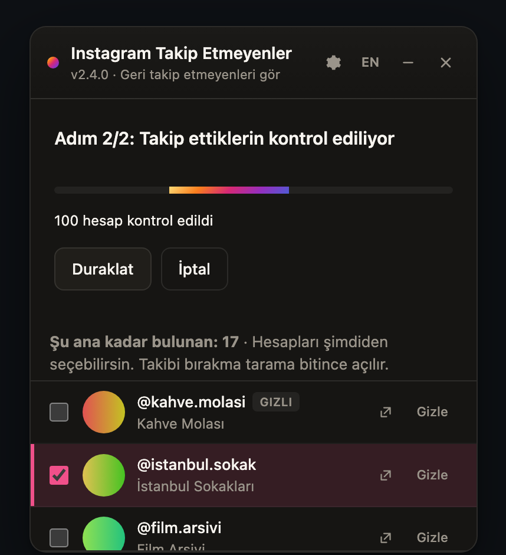

<p align="center">
  
</p>

<p align="center">
  Find the Instagram accounts that do not follow you back.<br>
  In your own browser tab, in your own session, with no password given to anyone.
</p>

<p align="center">
  <a href="https://instagram.cobanov.dev">instagram.cobanov.dev</a> ·
  <a href="https://instagram.cobanov.dev/security.html">how to verify it</a>
</p>

<p align="center">
  <a href="https://github.com/cobanov/instagram/releases/latest"></a>
  
  
  <a href="https://github.com/cobanov/instagram/actions/workflows/semgrep.yml"></a>
</p>

---

Every tool that answers this question wants something first: your password, an OAuth
grant, or your follower list uploaded to somewhere you cannot see. None of that is
needed. Instagram already makes your following and follower lists available to the
logged-in browser. The whole job is comparing those lists inside the tab.

So this is a script you paste into your own DevTools console on your own Instagram
tab. It uses the session already in the browser. Nothing is sent anywhere: the site
is static, and there is no server on this side to receive anything.

- **It checks follow-back locally.** The scanner reads your follower and following
  counts, then takes whichever way costs Instagram fewer requests: download the follower
  list and compare it with the accounts you follow, or ask about each followed account.
- **Nothing leaves the tab.** No backend, no upload, no key. What the panel shows is
  what the browser already had.
- **Unfollowing is slow on purpose.** Rate limits, blocks and `checkpoint_required`
  are detected and stop the run rather than being retried into a ban.
- **A floating panel, TR and EN**, with search, filters, hide/unhide and copy.
- **The exact bytes are published.** The security page shows the SHA-256 of the file
  it is serving.

## Install

Two ways to run it. They execute the same file, byte for byte.

**The console snippet.** Sign in at `https://www.instagram.com`, open DevTools
Console, copy the snippet from [instagram.cobanov.dev](https://instagram.cobanov.dev),
paste it and press Enter. If Chrome refuses the paste, type `allow pasting` in the
console first.

**The Chrome extension**, if you would rather not touch a console. Download the zip
from the [latest release](https://github.com/cobanov/instagram/releases/latest),
unpack it, and load it unpacked from `chrome://extensions` with developer mode on.
Clicking its toolbar icon injects the same script. Contributed by
[yavuzmeteafsar](https://github.com/yavuzmeteafsar); see
[chrome-extension/README.md](chrome-extension/README.md).

## Use

Click **Scan now**. The panel walks your following and follower lists, then shows the
accounts that do not follow you back. When Instagram omits unavailable followed
accounts, a notice explains how many accounts the results cover.

Instagram hands followers out 25 per page whatever page size is asked for, so a large
account is a few hundred requests and can still take many minutes. The following list
honours the requested size, which is 200 since 2.5.0 (it was 50), so it takes a quarter of
the requests. Version 2.3.4 follows upstream's current two-stage randomized scan pacing;
the requested page size can be set from 1 to 200 under Settings. Keep the tab in front while it runs:
Chrome can heavily throttle background timers. Instagram can still interrupt scans,
especially on large accounts; slower requests do not guarantee completion.

If Instagram cuts the scan short (signs you out, rate-limits, asks for a checkpoint),
progress is kept in the tab's `localStorage` for a day. **No non-follower results or
unfollow actions are available before the required checks finish.** Wait for the restriction
to clear, sign in again if necessary, then press **Resume**. A rate limit stops the
scan immediately; it is not retried automatically. Instagram often sends its rate limit as
a 401 with `require_login` and "Please wait a few minutes"; since 2.4.1 that is reported as
a rate limit, not a sign-out, because signing in again does not lift it. The panel names a
time to resume, and until then Resume sends nothing: one hour after a rate limit, three
hours after a block or a long run of empty pages.

Since 2.5.0 a large follower list is no longer downloaded when that is the expensive way.
Instagram serves followers 25 a page, so an account with 30,000 followers needs about
1,200 pages, and Instagram cuts scans off after a few hundred. The scan first reads the two
counts from your profile. When you follow fewer accounts than the follower list has pages
left, it loads the accounts you follow and asks Instagram about each one
(`/api/v1/friendships/show/<id>/`). Every answer is final and saved, so non-followers show up
as they are found, and the ones found so far can be unfollowed even if Instagram stops the
scan. If Instagram does not answer that question, the scan falls back to downloading the
follower list.

Progress is saved after every page and every answer, in the page's storage, which holds
about 5 million characters. Before 2.5.0 each followed account was saved with its picture
link, about 650 characters, so progress stopped being saved at about 7,700 followed accounts at most (sooner with a
large follower list) and
Resume lost what came after. It is now saved without picture links (about 130 characters an
account); a resumed list shows no pictures.

**Unfollow from a list** (since 2.5.0) needs no scan at all. Paste usernames one per line,
such as the list from `/export` or one copied from an earlier result, and the panel unfollows
them at the usual pace. Only the first word of each line is read, so dates or names copied
along with a username never become accounts to unfollow. Each account is first looked up among the people you follow and skipped if you
do not follow it. The pasted list is not checked for who follows you back.

Since 2.4.2, HTTP 200 with an HTML body is not an empty follower list. The final URL and the
page separate a login redirect, a challenge, a "please wait" page, and the logged-in shell.
That request is retried a few times with a short wait. If it is still HTML, Instagram is
holding the list back: one user who kept resuming into it could not open their follower list
in the Instagram app until the next day. Since 2.5.0 the scan then pauses for three hours like
a block, and the Resume and Start over buttons say when they open again instead of answering
with the same error. A follower count of 0 from that reply stays an error.

Instagram sometimes sends a run of empty pages in the middle of a list, or ends a list
while still claiming there is more. Since 2.4.1 the scan steps over up to ten empty pages
in a row and treats a missing or repeated cursor as the end of the list. In the following
list that can only miss non-followers. In the follower list it could show a follower as a
non-follower, so those results are marked unverified and unfollowing stays off; the data
file method at `/export` gives exact results. A longer run of empty pages stops the scan.
A failed scan shows one line with the version, the list, how far it got and what Instagram
sent.

When upgrading from a version older than **2.3.2**, refresh the Instagram tab before running the new code or
reloading the updated extension. Earlier versions could keep a scan running after
closing the panel, so simply pasting over the old panel is not enough to stop those
old requests. Version 2.3.2 stops its requests when closed or replaced, including
when switching between the console script and Chrome extension.

Unfollowing from the panel is deliberately unhurried. Instagram answers a burst of
unfollows with `feedback_required`, a spam flag, a checkpoint, or an HTTP 429, and
each of those is treated as a stop rather than as something to retry. An HTTP 401
means the session died and also stops the run. Pushing through any of them is how
accounts get restricted.

Since 2.4.3 the unfollow screen shows the time elapsed and about how long is left. The
estimate comes from the timings, not the pace so far: one request for each user left, the
delay between them, and the cooldowns still ahead.

## How to verify it before pasting

Pasting a stranger's JavaScript into a logged-in Instagram tab is a real thing to be
careful about, so the point of the security page is to make the file checkable rather
than to ask for trust.

```sh
npm run build      # prints the SHA-256 it just wrote
shasum -a 256 dist/instagram-unfollower.one-line.js
```

That value must match the hash shown on
[security.html](https://instagram.cobanov.dev/security.html). The page derives its
hash from the bytes it is actually serving rather than from a constant in this
repository, so it cannot go stale and vouch for a file nobody is downloading.
`src/instagram-unfollower.js` is the source of all of it and is short enough to read.

The extension's copy is generated by the same build step rather than hand-copied, so
it is byte-identical to `dist/` and the published hash verifies it too.

## Development

```
npm run build   # bundles src/ into dist/ and prints the new snippet hash
npm run check   # syntax checks and regression tests
npm run pack    # builds, then zips chrome-extension/ into .pack/ for a release
```

The tests cover the part that is genuinely dangerous: what counts as a successful
unfollow, and which failures must stop the run. An HTTP 200 carrying
`status: "fail"`, an HTML login page, challenge page, rate-limit page, or logged-in
shell served with 200, a spam flag, a checkpoint, a 429 and a 401 are each asserted
to be handled as themselves rather than as a completed list. HTML replies are retried,
then paused without turning a follower count of 0 into a result. The scan tests cover the current friendship-list endpoints,
pagination, repeated-cursor protection, and the local following/follower comparison.
They also verify cancellation, duplicate-start prevention, immediate rate-limit
stops, HTTP 200 errors, silently truncated lists, and disabled partial results.
The rest check that no language file is missing a key or leaves one empty.

## Sponsorship

Around **38k unique visitors per 30 days** (OpenAnalytics, September 20 to October 20,
2026).

If it is useful to you, you can sponsor it at
[github.com/sponsors/cobanov](https://github.com/sponsors/cobanov).

Thanks to the people who have backed it:

- [rmncr](https://github.com/rmncr), $25
- [Fatih Guzel](https://www.instagram.com/fatihguzeldev/), $10
- [Woosal](https://www.instagram.com/woosal1337/), $10

## Prior art

The workflow comes from
[davidarroyo1234/InstagramUnfollowers](https://github.com/davidarroyo1234/InstagramUnfollowers).
